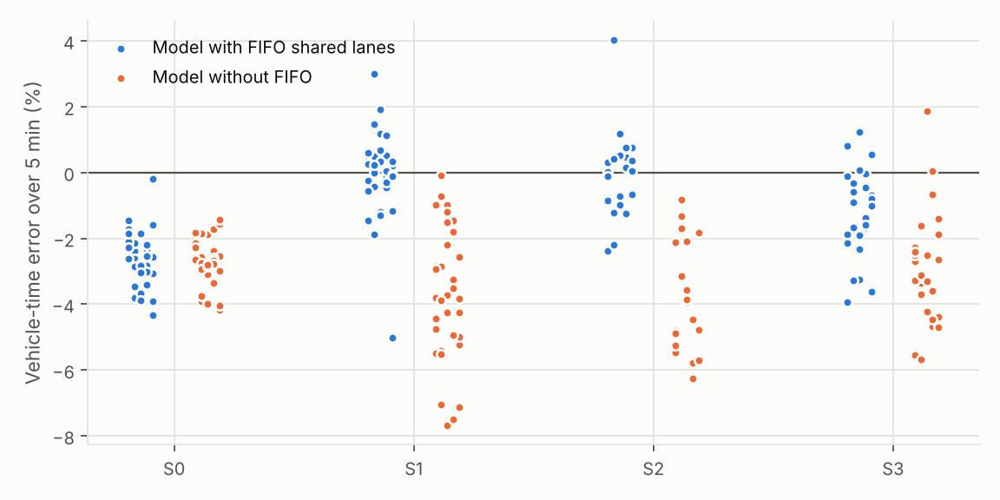
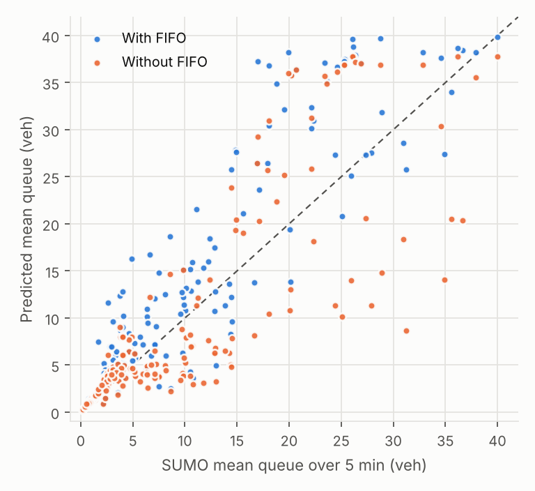
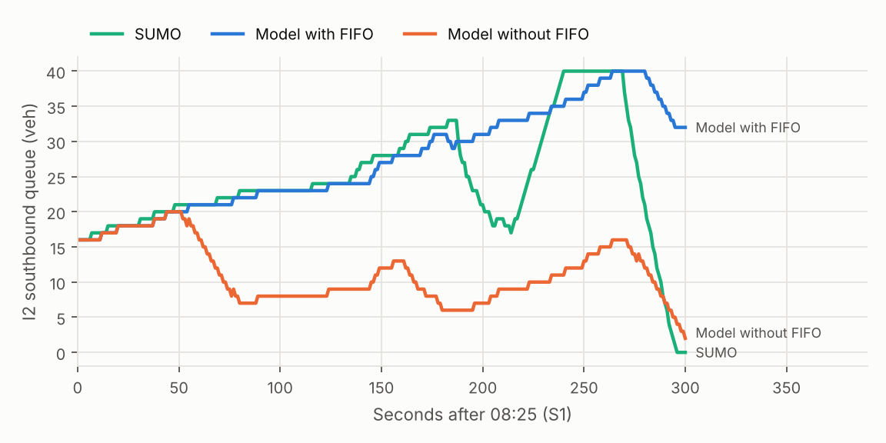

# Prediction model validation, Milestone 1

Generated by `python experiments/validate_prediction.py`. All numbers are in `prediction_model_m1.json`.

## Findings

1. **Vehicle-time over a 5 minute horizon is predicted within about 1 % in the loaded scenarios.** With FIFO shared lanes the bias is 0.0 % (S1), -0.1 % (S2) and -1.2 % (S3), with mean absolute errors of 0.8, 0.9 and 1.4 %. In light traffic (S0) the model under-predicts by 2.6 %, because SUMO vehicles take longer than free-flow time between signals (acceleration, slower leaders, turning speeds).
2. **FIFO shared lanes are necessary.** Without them the model under-predicts vehicle-time by 3.7 to 4.0 % in S1 to S3 and over-predicts I2 side-street throughput by 3 to 10 vehicles per approach per 5 minutes; with them, throughput bias is within about 2 vehicles.
3. **The FIFO model still over-states I2 shared-lane queues** by about 1 to 6 vehicles on average: its permissive left-turners find gaps less readily than SUMO's. About 2 vehicles of every queue difference is definitional (see below). Individual 5 minute queues are noisy because one left-turner's wait for a gap decides whether the lane flows.
4. **Baseline finding for review: I2's side streets are oversaturated in S2.** An I2 side-street queue is at or near its full 40-vehicle storage 45 % of the time, and up to 57 vehicles wait outside the network at an I2 side-street entry. Document Zero intends the I4 eastbound lane drop to be the bottleneck. The cause is the Milestone 1 combination of one shared lane, a permissive left with no end-of-phase sneakers, and splits sized from flow ratios that ignore left-turn impedance.

## What was tested

The corridor queue model (`src/cadence/prediction/queue_model.py`) is the simplified model an optimizer would roll forward. Every 5 minutes after the 15 minute warm-up, in each scenario, it was initialized from SUMO's true state (every vehicle's position, speed and remaining route, and the insertion backlog) and predicted the next 5 minutes, given the true future entries and the signal states SUMO actually showed. Its errors are therefore structural: what the simplification costs, before any estimation error.

Two versions are compared: the model with first-in-first-out (FIFO) shared lanes, where a vehicle that cannot go blocks the lane behind it, and the same model without FIFO, where each movement in a shared lane queues as if it had its own lane.

Measures: system vehicle-time over the 5 minutes (backlog plus network, the quantity in the cost J); the mean queue on each approach over the 5 minutes; and the number of vehicles discharged by each movement.

Queues are not defined identically: SUMO's are halted vehicles (speed below 0.1 m/s) on the approach, while the model's are all vehicles that have reached the stop line and not yet left, including those moving off at the start of green. This alone makes model queues about 2 vehicles longer on busy approaches (the mainline bias in the table).

## Calibration

Only the two permissive-left gap parameters were fitted, on S1, scored on the I2 shared-lane queues; S0, S2 and S3 are out of sample. Saturation headway (2.0 s), start-up lost time (2 s), yellow use (2 s) and free-flow speed are fixed at their Document Zero or textbook values.

| No opposing departure in the last (s) | No opposing arrival in the next (s) | I2 mean queue MAE (veh) | I2 mean queue bias (veh) | Vehicle-time mean abs. error |
| --- | --- | --- | --- | --- |
| 0.0 | 0.0 | 4.332 **(chosen)** | +3.03 | 0.85 % |
| 0.0 | 1.0 | 4.479 | +3.21 | 0.88 % |
| 0.0 | 2.0 | 4.594 | +3.38 | 0.80 % |
| 0.0 | 3.0 | 4.79 | +3.39 | 0.78 % |
| 1.0 | 0.0 | 4.458 | +3.21 | 0.89 % |
| 1.0 | 1.0 | 4.623 | +3.39 | 0.87 % |
| 1.0 | 2.0 | 4.627 | +3.49 | 0.82 % |
| 1.0 | 3.0 | 4.974 | +3.52 | 0.79 % |
| 2.0 | 0.0 | 4.582 | +3.71 | 0.83 % |
| 2.0 | 1.0 | 4.68 | +3.84 | 0.90 % |
| 2.0 | 2.0 | 4.785 | +3.93 | 0.90 % |
| 2.0 | 3.0 | 4.872 | +3.93 | 0.88 % |

## Results

| Scenario | Model | Starts | Vehicle-time bias | Mean abs. error | 90th pct abs. error | Mean queue MAE (veh): mainline | side, own lanes | I2 shared lanes | I2 shared-lane throughput bias (veh) | Discharges per movement MAE (veh) |
| --- | --- | --- | --- | --- | --- | --- | --- | --- | --- | --- |
| S0 | FIFO | 33 | -2.64 % | 2.64 % | 3.68 % | 0.48 | 0.3 | 0.29 | +0.0 | 0.13 |
| S0 | no FIFO | 33 | -2.69 % | 2.69 % | 3.91 % | 0.49 | 0.29 | 0.27 | +0.0 | 0.13 |
| S1 | FIFO | 33 | -0.01 % | 0.85 % | 1.47 % | 2.07 | 1.99 | 4.33 | -1.6 | 0.71 |
| S1 | no FIFO | 33 | -3.72 % | 3.72 % | 5.50 % | 2.12 | 1.73 | 4.46 | +6.5 | 1.06 |
| S2 | FIFO | 21 | -0.06 % | 0.92 % | 2.20 % | 2.64 | 2.11 | 7.37 | -2.4 | 1.11 |
| S2 | no FIFO | 21 | -3.96 % | 3.96 % | 5.77 % | 2.65 | 1.94 | 8.41 | +10.1 | 1.63 |
| S3 | FIFO | 27 | -1.25 % | 1.45 % | 3.25 % | 1.88 | 1.91 | 2.09 | -0.2 | 0.5 |
| S3 | no FIFO | 27 | -2.97 % | 3.11 % | 4.66 % | 1.94 | 1.75 | 1.83 | +2.9 | 0.75 |

*Each dot is one 5 minute prediction. Error = (model − SUMO) / SUMO.*

## Shared-lane head-of-line blocking

I2's side streets have one lane for left, through and right traffic, and the left turn is permissive. In SUMO a left-turner waiting for a gap holds up everything behind it. The figure compares the mean I2 side-street queue over each 5 minute horizon. Points along the top are horizons in which the 40-vehicle side-street storage was full.

*Each dot is one approach (I2 northbound or southbound) at one start time; the dashed line is perfect prediction.* Below, the horizon (among those where the side street was not full) where FIFO made the largest difference (S1, I2 SB).

## I2 side-street spillback by scenario

| Scenario | Share of time an I2 side-street queue is 36 vehicles or more | Largest entry backlog (vehicles, by entry) |
| --- | --- | --- |
| S0 | 0 % | none |
| S1 | 5 % | N1 2, N2 6, S1 1, S2 9 |
| S2 | 45 % | EB 2, N2 57, S2 36 |
| S3 | 0 % | PULSE_I3NB 27, S3 37 |

In S3 the backlog at I3 northbound (stream S3 and the pulse) is the intended Document Zero disruption. Options for the I2 side streets, for review: size the I2 side splits for the shared lane's real capacity, lower the Milestone 1 I2 cross-street volumes within the Document Zero range, or restore end-of-phase left turns once the junction-clearing issue in corridor_r1.md is solved another way.

## Known structural limits

- Point queues: vehicles join a queue when they reach the stop line, not when they reach the back of the queue, so delay upstream of long queues is shifted in time.
- One saturation headway (2.0 s) for every lane and movement; turning movements in SUMO are slower.
- Free-flow speed is the posted speed for every vehicle; SUMO drivers vary their desired speed.
- Permissive lefts use a fixed gap rule; SUMO's gap acceptance depends on the approaching vehicles' speeds and distances.
- Left-turn bay overflow is represented by a left-turner blocking the adjacent through lane once it cannot enter the bay; the exact position where it waits is not modeled.

